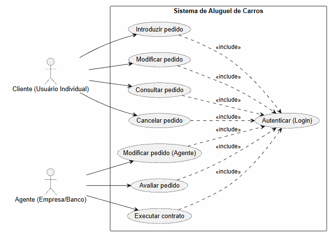

<h1 style="color: #0946B5;">
  Diagrama de Casos de Uso
</h1>

<h2 style="color: #0946B5;">1. Diagrama Visual</h2>

 

<h2 style="color: #0946B5;">2. Atores</h2>

* **Cliente (Usuário Individual):** 
  > Pessoa física cadastrada no sistema. Deseja alugar veículos e gerenciar seus próprios pedidos.

* **Agente (Empresa/Banco):** 
  > Usuário corporativo com permissões gerenciais. Responsável por analisar o perfil financeiro dos clientes e gerir o andamento dos contratos de aluguel.

 

<h2 style="color: #0946B5;">3. Descrição dos Casos de Uso</h2>

<h3 style="color: #26D0FA;">Casos de Uso Gerais</h3>

* **Autenticar (Login):** 
  Valida as credenciais (usuário e senha) do Cliente ou Agente. É um requisito obrigatório (`<<include>>`) para qualquer outra ação no sistema, garantindo que usuários anônimos não tenham acesso.

<h3 style="color: #26D0FA;">Casos de Uso do Cliente</h3>

* **Introduzir pedido:** 
  Permite que o cliente crie um novo pedido de aluguel de veículo, selecionando as opções desejadas e fornecendo os dados necessários (identificação, rendimentos, etc.).

* **Modificar pedido:** 
  Permite ao cliente alterar os detalhes de um pedido de aluguel que ainda não foi executado (ex: trocar a data ou o modelo do carro).

* **Consultar pedido:** 
  Permite ao cliente visualizar o status e os detalhes de seus pedidos de aluguel atuais e passados.

* **Cancelar pedido:** 
  Permite ao cliente desistir e cancelar um pedido de aluguel pendente.

<h3 style="color: #26D0FA;">Casos de Uso do Agente</h3>

* **Modificar pedido (Agente):** 
  Permite ao agente alterar informações técnicas atreladas a um pedido de um cliente.

* **Avaliar pedido:** 
  O agente analisa os dados do pedido do cliente sob o ponto de vista financeiro, verificando renda, histórico e viabilidade de crédito.

* **Executar contrato:** 
  Após um parecer financeiro positivo na avaliação, o agente gera e formaliza o contrato de aluguel/crédito, consolidando a operação.