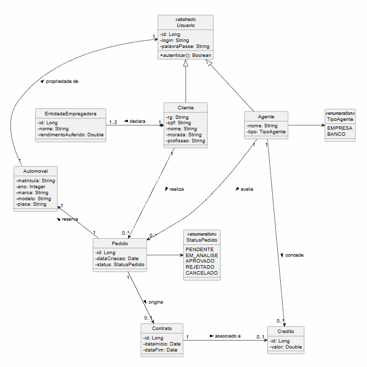

<h1 style="color: #0946B5;">
  Diagrama de Classes
</h1>

<h2 style="color: #0946B5;">1. Diagrama Visual</h2>

 

<h2 style="color: #0946B5;">2. Dados e Entidades</h2>

<h3 style="color: #26D0FA;">2.1. Usuários e Autenticação</h3>

* **Usuario (`<<abstract>>`):** 
  Superclasse que centraliza a obrigatoriedade de autenticação. Todo usuário do sistema possui um `id`, `login` e `palavraPasse`.
  
* **Cliente:** 
  Herda de `Usuario`. Representa as pessoas físicas que realizam os pedidos. Armazena dados pessoais (`rg`, `cpf`, `nome`, `morada`, `profissao`).

  O cadastro é feito pela API de autenticação. Depois de autenticado, o cliente pode consultar, atualizar e excluir o próprio perfil; os dados de senha não são incluídos nas respostas da API de perfil.
  
* **Agente:** 
  Herda de `Usuario`. Representa as entidades corporativas. Possui um `nome` e um `tipo` (definido pelo enumerador `TipoAgente` como EMPRESA ou BANCO).

<h3 style="color: #26D0FA;">2.2. Entidades Relacionadas ao Cliente</h3>

* **EntidadeEmpregadora:** 
  Representa uma fonte de renda do cliente. Possui `nome`, `rendimentoAuferido` e associação de composição com Cliente. Cada cliente pode informar até três entidades, cada uma com rendimento maior que zero; o cadastro é opcional.

<h3 style="color: #26D0FA;">2.3. Gestão de Veículos e Pedidos</h3>

* **Automovel:** 
  Registra os dados dos veículos (`matricula`, `ano`, `marca`, `modelo`, `placa`). É associado de forma genérica à superclasse `Usuario`, pois pode ser propriedade de clientes, empresas ou bancos.
  
* **Pedido:** 
  Centraliza a intenção de aluguel do cliente. Possui uma `dataCriacao` e um `status` (controlado pelo enumerador `StatusPedido`: PENDENTE, EM_ANALISE, APROVADO, AGUARDANDO_EXECUCAO, CONTRATO_EXECUTADO, REJEITADO, CANCELADO). Um pedido reserva exatamente um automóvel.

  No protótipo, cada pedido é associado ao cliente autenticado, a um automóvel cadastrado e ao período solicitado. O endpoint `POST /api/pedidos/me` inicia o status como `EM_ANALISE`; `GET /api/pedidos/me` permite ao cliente acompanhar os próprios pedidos. Uma pequena frota de demonstração é criada apenas quando a tabela de automóveis está vazia.

  Agentes consultam os pedidos em análise e os rendimentos declarados do cliente em `GET /api/agente/pedidos`. O texto do parecer é registrado em `PATCH /api/agente/pedidos/{id}/parecer` junto com a decisão, atualizando o status para `APROVADO` ou `REJEITADO`; o cliente também pode consultar o parecer.

  Enquanto o pedido estiver em análise, o agente pode alterar o automóvel e as datas em `PUT /api/agente/pedidos/{id}`. O pedido permanece em análise após a atualização.

  Após o parecer positivo, o agente consulta pedidos aprovados em `GET /api/agente/pedidos/aprovados` e pode encaminhá-los para consideração da execução do contrato em `PATCH /api/agente/pedidos/{id}/execucao`. O status passa para `AGUARDANDO_EXECUCAO`; os pedidos encaminhados são consultados em `GET /api/agente/pedidos/execucao`. O agente então formaliza o contrato em `POST /api/agente/contratos/pedidos/{id}/execucao`; o contrato referencia o pedido e, por ele, cliente, automóvel e período. Agente de banco pode registrar detalhes opcionais do crédito. Após a formalização o pedido passa a `CONTRATO_EXECUTADO`; o cliente consulta contratos em `GET /api/contratos/me`.

<h3 style="color: #26D0FA;">2.4. Contratos e Financiamentos</h3>

* **Contrato:** 
  Gerado exclusivamente a partir de um pedido aprovado por um Agente. Define a `dataInicio` e `dataFim` do aluguel.
  
* **Credito:** 
  Representa um financiamento que pode estar associado a um contrato. Este crédito é concedido obrigatoriamente por um Agente do tipo BANCO e possui um `valor` específico.