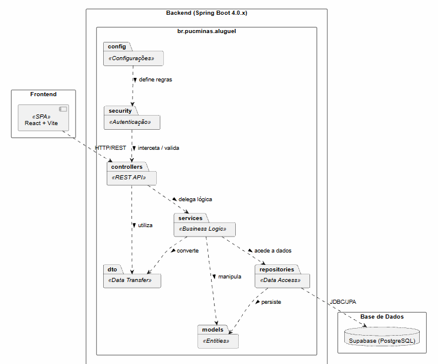

<h1 style="color: #0946B5;">
  Diagrama de Pacotes (Visão Lógica)
</h1>

<h2 style="color: #0946B5;">1. Diagrama Visual</h2>

 

<h2 style="color: #0946B5;">2. Camadas e Componentes</h2>

<h3 style="color: #26D0FA;">2.1. Frontend</h3>

* **React + Vite:** 
  Responsável pela interface do usuário. Comunica-se com o back-end exclusivamente via requisições HTTP (REST API). Garante uma navegação fluida e dinâmica, construindo dinamicamente as páginas web.

<h3 style="color: #26D0FA;">2.2. Backend (Spring Boot 4.0.x)</h3>

Todo o back-end está contido no pacote base `com.example.rentcar` e é subdividido nas seguintes camadas lógicas:

* **config (`<<Configurações>>`):** 
  Classes de configuração geral do projeto.
* **security (`<<Autenticação>>`):** 
  Intercepta as requisições para garantir o cumprimento do requisito obrigatório de autenticação. Nenhuma rota de negócios pode ser acessada sem um login válido.
* **controllers (`<<REST API>>`):** 
  Recebe as requisições HTTP do front-end, delega o processamento para a camada de serviços e retorna as respostas padronizadas.
* **services (`<<Regras de Negócio>>`):** 
  Contém as regras de negócio, como a validação do limite de rendimentos de um cliente, processamento de análise financeira pelos agentes e geração de contratos.
* **repositories (`<<Acesso ao banco de dados>>`):** 
  Interfaces Spring Data responsáveis pela persistência de dados. Fazem a ponte entre a aplicação Java e o banco de dados.
* **models (`<<Entidades>>`):** 
  Classes de domínio (Cliente, Agente, Pedido, Automovel, etc.) que são mapeadas diretamente para as tabelas do banco de dados relacional.
* **dto (`<<Objetos de Dados>>`):** 
  Objetos de Transferência de Dados. Usados para formatar e restringir os dados que entram e saem pelas APIs (ex: não expor senhas ao listar usuários).

<h3 style="color: #26D0FA;">2.3. Base de Dados</h3>

* **Supabase (PostgreSQL):** 
  Banco de dados relacional hospedado na nuvem que armazena todas as informações persistentes do sistema. O acesso é feito através dos `repositories` do Spring Boot utilizando JDBC/JPA.

<h3 style="color: #26D0FA;">2.4. CRUD de Cliente</h3>

O cadastro de cliente é realizado em `POST /api/auth/register`. Após a autenticação, o cliente pode consultar e atualizar somente o próprio perfil em `GET /api/clientes/me` e `PUT /api/clientes/me`, ou excluir a própria conta em `DELETE /api/clientes/me`. O controller obtém a identidade da sessão autenticada e delega as operações ao serviço e ao repositório de clientes.

Agentes autenticados podem consultar a fila financeira em `GET /api/agente/pedidos`, que apresenta os rendimentos declarados pelo cliente, e registrar a decisão e o texto do parecer em `PATCH /api/agente/pedidos/{id}/parecer`. O parecer registrado também é retornado ao cliente. Somente pedidos em análise podem ser aprovados ou reprovados.

Na mesma fila, o agente pode editar o automóvel e o período do pedido em `PUT /api/agente/pedidos/{id}`; a edição só é permitida enquanto o pedido estiver em análise.

Pedidos aprovados aparecem em `GET /api/agente/pedidos/aprovados`. O agente pode encaminhar um pedido para consideração da execução do contrato em `PATCH /api/agente/pedidos/{id}/execucao`; somente pedidos aprovados podem avançar para `AGUARDANDO_EXECUCAO`. A fila `GET /api/agente/pedidos/execucao` permite consultar os pedidos encaminhados. A formalização cria um contrato ligado ao pedido por `POST /api/agente/contratos/pedidos/{id}/execucao`. Somente agente de banco pode preencher os detalhes opcionais do crédito. Agentes consultam contratos formalizados em `GET /api/agente/contratos`, e clientes consultam os próprios contratos em `GET /api/contratos/me`.